  

# Awesome Market Intelligence 🌐🔍

  

> 💡 **A curated directory of market intelligence platforms, competitive research tools, corporate OSINT workbenches, and autonomous research pipelines.**

Market intelligence empowers organizations, corporate strategists, equity analysts, and founders to track competitor movements, monitor industry disruptions, analyze digital traffic, and synthesize high-conviction research from both proprietary networks and public web signals. 📈🚀

---

## 📑 Table of Contents

- [📊 Sector Overview & Market Dynamics](#-sector-overview--market-dynamics)
- [🏢 SaaS & Hosted Enterprise Platforms](#-saas--hosted-enterprise-platforms)
- [🛠️ Open-Source Market Intelligence Tools](#️-open-source-market-intelligence-tools)
- [🎯 Key Selection Criteria](#-key-selection-criteria)
- [⭐ Star History](#-star-history)
- [💖 Support & Sponsorship](#-support--sponsorship)
- [🤝 How to Contribute](#-how-to-contribute)
- [⚠️ Disclaimer](#️-disclaimer)

---

## 📊 Sector Overview & Market Dynamics

The global market intelligence and analytics software sector is estimated at **$8.6B – $12.1B in 2024**, projected to surpass **$19B – $21B by 2030** at a compound annual growth rate (**CAGR**) of **8.2% – 9.8%** (with AI-driven research engines accelerating further). 🚀

The market exhibits a **hybrid, bi-modal structure**: it is **highly concentrated at the enterprise financial and institutional core** (where financial data behemoths like Bloomberg, FactSet, and AlphaSense command deep moats and pricing power), yet **fragmented across the competitive intelligence, digital telemetry, and specialized research layer**, where dozens of venture-backed SaaS platforms and agile open-source AI pipelines continuously compete for niche analytical workflows. 🌐

---

## 🏢 SaaS & Hosted Enterprise Platforms

The table below catalogs leading commercial market and competitive intelligence platforms, sorted in descending order by enterprise scale (company valuation or annual revenue). 💼

| Product | Enterprise Scale (Revenue / Valuation) | Pricing | Free Tier / Trial Limits | Description |
| :--- | :--- | :--- | :--- | :--- |
| **[Bloomberg Terminal](https://www.bloomberg.com/professional/)** | **~$14.9B ARR** (Est. Enterprise Valuation: ~$60B+) | **$24,000 – $31,980/year per seat** (modular depending on firm size and regional contracts) | **No free tier**. 30-day institutional trial granted solely to qualified enterprise & buy-side prospects via account reps. | The global gold standard for real-time market data, broker research, multi-asset trading execution, and the IB institutional chat network. |
| **[FactSet](https://www.factset.com/)** | **~$12B – $17B Market Cap** ($2.2B annual revenue) | **Starts at $4,000 – $5,000/year** (basic access); full analytical workstation averages **~$25,000/seat/year** | **No free tier**. Limited 7-day to 14-day evaluation trial accessible only upon direct corporate sales qualification. | Institutional financial data and portfolio intelligence platform featuring earnings call transcripts, consensus estimates, and financial modeling. |
| **[AlphaSense](https://www.alpha-sense.com/)** | **$7.5B Valuation** ($600M+ ARR) | **Starts at $10,000 – $15,000/seat/year** (typical team deployments average ~$18,400 to $25,000/year) | **No permanent free tier**. 14-day business email trial with full semantic search across SEC filings and news (requires sales rep activation). | AI-powered market intelligence platform indexing broker equity research, expert call transcripts (Tegus), SEC filings, and corporate disclosures. |
| **[PitchBook](https://pitchbook.com/)** | **~$2.57B Parent Revenue** (Morningstar segment ~$500M+ ARR) | **Starts at $20,000 – $25,000/year** (team license covering 1–3 seats; $7,500 – $10,500/seat add-on) | **No free tier**. Guided 3-day to 7-day institutional trial with sample download limits available following a product demonstration. | Definitive private market intelligence provider tracking venture capital, private equity, M&A valuations, debt rounds, and executive contact networks. |
| **[Meltwater](https://www.meltwater.com/)** | **~$592M – $1B Valuation** (~$450M – $558M ARR) | **Starts at $10,000/year** (Starter tier; Pro tier starts at $25,000/year; median contract ~$25,800/year) | **No free tier**. Custom demonstration with temporary 7-day sandboxed sample query access provided for enterprise prospects. | Media monitoring, social listening, and executive brand intelligence platform tracking digital news outlets and consumer sentiment globally. |
| **[Similarweb](https://www.similarweb.com/)** | **~$730M – $780M Market Cap** (~$280M ARR) | **Starts at $125/month** billed annually ($199/month billed month-to-month) for Starter Web Intelligence | **Permanently free tier available** (up to 3 website metrics results per report, 3 months historical data, basic traffic ranking, browser extension). Also offers a 7-day trial with 15 queries/day (credit card required). | Digital traffic intelligence platform analyzing website audience analytics, referral breakdown, competitor bounce rates, and organic keyword share. |
| **[Klue](https://klue.com/)** | **$248M Valuation** (Series B; ~$38M – $88M estimated ARR) | **Starts at $15,000 – $20,000/year** (enterprise go-to-market deployments average $35,000 – $40,000/year) | **No free tier**. No self-serve trial; bespoke 14-day proof-of-concept available strictly after sales qualification and NDA execution. | Competitive enablement and win-loss intelligence suite that curates real-time competitor tracking into actionable battlecards for enterprise sales teams. |
| **[CB Insights](https://www.cbinsights.com/)** | **~$70M – $100M ARR** (Est. Private Valuation: ~$500M+) | **Starts at $24,000 – $25,000/year** (median contract averages ~$47,000/year; enterprise tiers reach $100,000+) | **No permanent free tier**. 10-day trial with capped search results and restricted company profile views granted to qualified corporate domains. | Tech market intelligence platform offering predictive startup valuations, patent analytics, technology vendor scorecards, and customer feedback data. |
| **[Crayon](https://www.crayon.co/)** | **~$10M – $15M ARR** (Series B funded) | **Starts at $12,000 – $15,000/year** (median mid-market contracts range ~$30,000/year) | **No free tier**. No public self-service signup; bespoke sales demo with sample competitor telemetry report provided on request. | Automated competitive intelligence workbench tracking website changes, pricing pivots, hiring trends, and competitive battlecard integrations. |

---

## 🛠️ Open-Source Market Intelligence Tools

Open-source intelligence (OSINT) repositories and self-hosted research agents enable engineering teams and analysts to circumvent high-cost enterprise software contracts while customizing their data pipelines. 🔓💻

The repositories below are ranked in descending order by **GitHub_Stars_Count**. ⭐

- **[OpenBB](https://github.com/OpenBB-finance/OpenBB)**   
  *Open-source investment research platform and financial market data terminal.* Integrates macroeconomic databases, equity fundamentals, crypto telemetry, SEC filings, and proprietary LLM copilot agents into a modular Python API and CLI. 📊
- **[last30days-skill](https://github.com/mvanhorn/last30days-skill)**   
  *Multi-source research synthesis agent for modern AI workflows.* Automatically ingests discussions, videos, and sentiment from Reddit, X, YouTube, Hacker News, Polymarket, and web searches from the last 30 days to produce evidence-backed market research with exact citations. 🔍
- **[SpiderFoot](https://github.com/smicallef/spiderfoot)**   
  *Automated open-source intelligence (OSINT) and external digital asset reconnaissance tool.* Queries 100+ public data sources to gather intelligence on corporate domains, IPs, DNS records, technologies, and corporate footprint disclosures. 🕵️
- **[ai-marketing-claude](https://github.com/zubair-trabzada/ai-marketing-claude)**   
  *AI marketing and competitive research suite.* Orchestrates 15 specialized marketing subagents for competitor audits, ad campaign intelligence, brand positioning analysis, and PDF report generation. 🤖
- **[startup-skill](https://github.com/ferdinandobons/startup-skill)**   
  *Autonomous market validation and competitor discovery skill.* Evaluates business concepts, performs competitive intelligence sweeps, and extracts market positioning opportunities using AI agent reasoning. 💡
- **[unifapi-agent](https://github.com/unifapi-agent/agents)**   
  *Multi-agent marketing and competitive intelligence engine.* Conducts competitor SEO audits, social listening, influencer pricing analysis, and visibility tracking across LLM responses using Model Context Protocol (MCP). 📡
- **[fintool](https://github.com/second-state/fintool)**   
  *Rust CLI suite for financial intelligence and algorithmic market data analysis.* Aggregates quotes, news feeds, prediction market odds, and SEC filings across multiple exchange protocols and commodity feeds. 🦀
- **[free-online-competitive-intelligence](https://github.com/SourcingDenis/free-online-competitive-intelligence)**   
  *Curated collection of 40+ free competitive intelligence and investigation utilities.* Hand-picked tools for conducting corporate research, competitor background vetting, and domain forensics. 🧰
- **[StartupKit](https://github.com/mohamedameen-io/StartupKit)**   
  *Interactive ideation and market research framework.* Guides teams through competitive landscape mapping, market sizing calculations, target customer research, and pitch deck validation. 🚀
- **[open-market-intelligence](https://github.com/lulu930128/open-market-intelligence)**   
  *Local-first market intelligence workbench.* Built with FastAPI and Next.js for evidence-driven investment research, company financial extraction, and custom industry reports. 📑
- **[OmniSight](https://github.com/HamzaKhanBUIC/OmniSight-Autonomous-Corporate-Strategy-Disruption-Radar)**   
  *Autonomous corporate strategy disruption radar.* Synthesizes live web telemetry, audio transcripts with speaker diarization (earnings calls), and graph memory into interactive strategy radars. 🎯
- **[JingXi](https://github.com/geyuzi11/jingxi-competitive-intelligence)**   
  *Structured competitive intelligence analyzer.* Extracts 16 signal scores across positioning, growth archaeology (Wayback machine diffs), traffic channels, and next moves within 60 seconds from any competitor URL. ⚡
- **[InfoEdge](https://github.com/gaoyu666/infoedge)**   
  *Open-source intelligence workbench for market trend discovery.* Monitors news, online communities, financial signals, and supply chains with FastAPI scoring pipelines and customizable UI cards. 🧭

---

## 🎯 Key Selection Criteria

When deciding between enterprise SaaS suites and self-hosted open-source intelligence pipelines: ⚖️

1. **🔒 Proprietary Data Moats**: Platforms like AlphaSense, Bloomberg, and PitchBook possess exclusive institutional rights to equity broker reports, expert transcript libraries (e.g. Tegus, Stream), and private equity capitalization tables.
2. **⚡ Real-time Telemetry vs. Batch Scrapes**: Similarweb and Crayon supply near real-time clickstream telemetry and website change detection. Open-source pipelines require external API keys (SerpApi, Tavily, Exa, Bright Data) or headless scrapers.
3. **💰 Total Cost of Ownership (TCO)**: Enterprise CI platforms routinely cost $15,000 to $50,000+ per year on locked multi-year contracts. Open-source stacks run locally or on basic cloud instances, incurring costs only for raw LLM tokens and API calls.
4. **🛡️ Data Sovereignty & Local Privacy**: Regulated institutions, hedge funds, and M&A advisory teams frequently turn to self-hosted tools (like OpenBB, SpiderFoot, and local LLM pipelines) to avoid leaking search intent or deal targets to third-party vendor analytics.

---

##  Star History

---

## 💖 Support & Sponsorship

Thank you so much for exploring and using **Awesome Market Intelligence**! 🙌

If you find this repository valuable for your research, team, or workflows, please consider supporting its ongoing maintenance and curation:

- ⭐ **Star this repository** on GitHub to help others discover it!
- 🍴 **Fork it** and contribute your own discoveries or open-source projects.
- 📢 **Share it** with fellow researchers, analysts, and developers.
- ☕ **Buy a coffee & sponsor**: Support the creator directly via the [GitHub Sponsors Dashboard](https://github.com/sponsors/ishandutta2007).

Every bit of encouragement and sponsorship keeps this ecosystem updated and free for the community! 🌟

---

## 🤝 How to Contribute

Contributions are warmly welcomed! To suggest a SaaS platform or an open-source tool: 🛠️

1. 🍴 Fork this repository.
2. ✍️ Edit `README.md` keeping entries sorted according to their section guidelines (descending company scale for SaaS, descending GitHub_Stars with badge for Open-Source).
3. 📋 Ensure all table columns (Pricing, Free Tier/Trial limits, Scale) provide factual, specific figures.
4. 🚀 Open a Pull Request detailing the tool's core utility and market relevance.

---

## ⚠️ Disclaimer

This repository is curated for informational and educational purposes. Product pricing, trial limits, and corporate valuations fluctuate regularly based on vendor policies and market conditions. Verify current terms directly with vendor representatives before making procurement decisions. 📌
